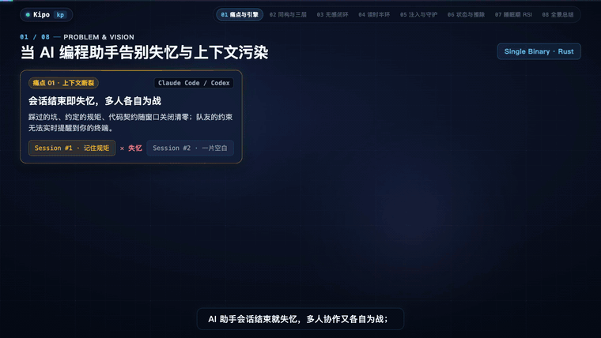

<p align="center">
  <picture>
    <source media="(prefers-color-scheme: dark)" srcset="docs/assets/kipo-hero-dark.svg">
    
  </picture>
</p>

<p align="center">
  <a href="https://github.com/junjamrk/kipo/actions/workflows/ci.yml"></a>
  <a href="https://github.com/junjamrk/kipo/releases"></a>
  <a href="LICENSE"></a>
  <a href="rust-toolchain.toml"></a>
</p>

<p align="center">
  <strong>English</strong> ·
  <a href="README.zh-CN.md">简体中文</a> ·
  <a href="#quick-start">Quick start</a> ·
  <a href="#what-kipo-does-for-you">What it does</a> ·
  <a href="#how-kipo-fits-your-workflow">Workflow</a> ·
  <a href="#cli-at-a-glance">CLI</a> ·
  <a href="TUTORIAL.md">Tutorial</a> ·
  <a href="examples/showcase/README.md">Benchmarks</a> ·
  <a href="docs/ARCHITECTURE.md">Architecture</a>
</p>

# Kipo (`kp`)


Your coding agent forgets yesterday's fix, and it will run the migration your team froze an hour ago. **Kipo gives Claude Code, Codex, Cursor, and Windsurf a memory and a command guard that live in one local file, `kp.sqlite`, with no cloud account.**

<br clear="right">

<p align="center">
  
</p>

## Watch the trailer

<p align="center">
  <a href="https://github.com/junjamrk/kipo/raw/main/docs/assets/kipo-explainer.mp4">
    
  </a>
</p>

<p align="center">
  <a href="https://github.com/junjamrk/kipo/raw/main/docs/assets/kipo-explainer.mp4">
    
  </a>
</p>

<p align="center">
  <a href="https://github.com/junjamrk/kipo/raw/main/docs/assets/kipo-explainer.mp4"><strong>Play the trailer (MP4 with audio)</strong></a> ·
  <a href="docs/assets/kipo-explainer.mp4">View video file</a> ·
  <a href="TUTORIAL.md">Run the 5-minute offline tour</a>
</p>

## The problem Kipo fixes

| Every week you... | Kipo... |
| --- | --- |
| Re-explain the fix your agent found yesterday | Puts it back into the next prompt in 250 tokens or less |
| Watch the agent run a command your team banned | Stops the command at `PreToolUse`, before it runs |
| Paste a giant `CLAUDE.md` into every session | Sends only the 3 memories that match the prompt |
| Avoid shared RAG because it leaks private notes | Shows each teammate only what they are allowed to see |

Everything stays in one SQLite file on your disk. Kipo works offline, and you can open the file, inspect it, or delete it whenever you want.

## Quick start

### Install

```sh
# Homebrew (macOS and Linux)
brew install junjamrk/tap/kipo

# macOS and Linux installer (checks SHA256SUMS before it installs)
curl -fsSL https://raw.githubusercontent.com/junjamrk/kipo/main/scripts/install.sh | sh

# Windows PowerShell
irm https://raw.githubusercontent.com/junjamrk/kipo/main/scripts/install.ps1 | iex

# From source
cargo install --git https://github.com/junjamrk/kipo kipo
```

> [!TIP]
> Every release archive has a Sigstore build attestation. Check a download with `gh attestation verify kipo-<target>.tar.gz --repo junjamrk/kipo`.

### Try it offline in one command

```sh
kp demo
```

The demo needs no API key and no network. It wires Claude Code and Codex hooks into a throwaway library, recalls context, blocks a forbidden command, and proves that a teammate outside the audience sees nothing. Add `--dir ./kipo-demo` to keep the library, then open it with `kp inspect --path ./kipo-demo/demo-lib --as alice`.

### Connect your agent

```sh
kp init --path ~/.kp/personal --owner alice --name "Alice Personal"
kp connect claude-code --project . --path ~/.kp/personal --as alice
kp connect codex --project . --path ~/.kp/personal --as alice
```

Cursor and Windsurf connect through MCP:

```sh
kp connect cursor --project . --path ~/.kp/personal --as alice
kp connect windsurf --global --path ~/.kp/personal --as alice
```

That is the whole setup. Kipo now captures each session in the background and never blocks your agent's turn.

## What Kipo does for you

### 1. Remembers across sessions in 250 tokens or less

On every prompt, the `UserPromptSubmit` hook adds at most 3 relevant memories, capped at 250 tokens, each with the quote it came from. A prompt with nothing relevant gets nothing added.

Kipo learns from your sessions on its own. To record something yourself, use `kp remember` for a fact and `kp dead-end` for an approach that failed:

```sh
kp remember --subject settle_invoice --predicate kp.core.note \
  --value "The flaky billing test is the lock order in settle_invoice" \
  --path ~/.kp/personal --as alice

kp dead-end --subject settle_invoice \
  --hypothesis "Retry the HTTP mock" --reason "The race is in the lock order, not the network" \
  --path ~/.kp/personal --as alice
```

Tomorrow's session starts with both, so the agent skips the dead end.

### 2. Stops dangerous commands before they run

Write a rule with a `[forbid: ...]` tag, and Kipo checks every shell command your agent tries against it:

```sh
cat > release-rules.md <<'EOF'
# Release rules
- constraint: Database freeze until Monday 09:00 UTC [forbid: `sqlx migrate`]
- constraint: Use pnpm, not npm [forbid: `npm install`] [allow: `pnpm install`]
EOF
kp add release-rules.md --extract --path ~/.kp/personal --as alice
```

When the agent runs `sqlx migrate run`, the `PreToolUse` hook stops it and cites the rule:

* **Claude Code** asks you to approve the command.
* **Codex** denies it and prints a one-time override, `kp allow kp-ref:<id>`, that expires in 10 minutes.

`[require_flag: <cmd> <flag>]` makes a flag mandatory, for example a `--schema` path on every migration.

### 3. Learns your codebase, docs, and the web

```sh
kp add ./docs --path ~/.kp/personal --as alice
kp add ./notes/runbook.docx --path ~/.kp/personal --as alice
kp add https://example.com/runbook.html --path ~/.kp/personal --as alice
```

`kp add` reads Markdown, source code (Rust, Python, TypeScript, JavaScript, Go), PDF, DOCX, PPTX, XLSX, HTML, and web pages. Kipo removes API keys, tokens, and passwords before anything reaches the database.

Pin a note to a function, and `kp verify` tells you when the code changes under it:

```sh
kp remember --subject settle_invoice --predicate kp.code.api_contract \
  --value "Validate the request schema version before settlement" \
  --repo . --file src/billing.rs --symbol settle_invoice --path ~/.kp/personal
kp verify --repo . --path ~/.kp/personal --json
```

### 4. Turns dead ends into `SKILL.md` overnight

`kp dream` reads your past Claude Code and Codex sessions and writes what worked into `SKILL.md` files your agent can load:

```sh
kp dream --sessions ~/.claude/projects --sessions ~/.codex/sessions --path ~/.kp/personal
kp skill list --path ~/.kp/personal
kp feedback check-api-contract --outcome helped --task pr-142 --path ~/.kp/personal
```

A skill goes live only after it helped on 2 different tasks and never hurt. It retires when it starts to hurt. Skills shared by teammates stay off until you run `kp skill approve <slug>`.

`kp dream` uses the `claude` or `codex` CLI you are already logged into. Set `KP_MODEL_POLICY=raw_only` to keep everything on your machine with zero network calls.

### 5. Forgets instantly and shares without leaking

<p align="center">
  
</p>

```sh
kp forget release-freeze --path ~/.kp/personal   # gone from every prompt and summary in 0 ms
kp purge release-freeze --path ~/.kp/personal    # erase the original text for good
kp inspect --path ~/.kp/personal --as alice      # local web UI: what Kipo remembers and why
```

When you want a team library, run it with the same `kp` binary:

```sh
kp init --community --owner admin --name "Eng Team" --path ./team-lib
kp member add alice --path ./team-lib --json
kp serve --community --listen 127.0.0.1:8080 --path ./team-lib

kp publish release-freeze --to http://127.0.0.1:8080 --token "$ALICE_TOKEN" \
  --audience alice,bob --path ~/.kp/personal
kp sync --from http://127.0.0.1:8080 --token "$BOB_TOKEN" --path ~/.kp/bob
```

Bob sees the freeze. Carol is not in the audience, so her searches come back empty, exactly as if the note never existed. Walk through the full team setup in [TUTORIAL.md](TUTORIAL.md).

## How Kipo fits your workflow

<p align="center">
  
</p>

Kipo embeds text on your machine with a local model by default. To use a hosted embedding model instead, run `kp providers list` to see the built-in recipes, which include `openai`, `voyage`, `google`, `openrouter`, and `ollama`.

## CLI at a glance

Every command takes `--path <DIR>` (the library), `--as <ACTOR>` (who is asking), and `--json` (machine-readable output).

| You want to | Commands |
| --- | --- |
| Set up and try it | `init`, `demo`, `status`, `connect` |
| Teach it something | `remember`, `dead-end`, `add`, `ingest` |
| Find and explain | `search`, `why`, `inspect`, `log` |
| Guard commands | `allow`, `review`, `reject` |
| Remove memories | `forget`, `purge` |
| Grow skills | `dream`, `skill list`, `skill approve`, `feedback` |
| Edit memories as Markdown | `export`, `apply` |
| Share with a team | `serve`, `member add`, `community join`, `publish`, `sync` |

Run `kp <command> --help` for every flag.

## Under the hood

Curious how 0 ms retraction and leak-proof permissions work? Kipo never copies permissions onto the summaries and warnings it builds. It works out who may see each one at read time, from the notes it was built on. Retracting a note, removing a teammate, or passing an expiry date changes what everyone sees on the very next read. Read [the architecture guide](docs/ARCHITECTURE.md) for the storage design and security rules, [the ingest schema](docs/INGEST-SCHEMA.md) to feed Kipo from your own scripts, [the benchmark replays](examples/showcase/README.md) for measured results, [TUTORIAL.md](TUTORIAL.md) for a full walkthrough, [CONTRIBUTING.md](CONTRIBUTING.md) to send a patch, and [SECURITY.md](SECURITY.md) to report a vulnerability.

## Development

Every test runs offline with no API keys:

```sh
python3 scripts/verify-oss-readiness.py
cargo fmt --all -- --check
cargo clippy --workspace --all-targets --all-features --locked -- -D warnings
KP_OFFLINE=1 KP_DISABLE_MODEL_DOWNLOAD=1 cargo test --workspace --all-features --locked
```

## Security, support, and license

* Report a vulnerability: [SECURITY.md](SECURITY.md)
* Get help: [SUPPORT.md](SUPPORT.md)
* Contribute: [CONTRIBUTING.md](CONTRIBUTING.md) and [CODE_OF_CONDUCT.md](CODE_OF_CONDUCT.md)
* Release history: [CHANGELOG.md](CHANGELOG.md)
* License: [Apache License 2.0](LICENSE). Third-party attributions are in [THIRD_PARTY_NOTICES.md](THIRD_PARTY_NOTICES.md).
