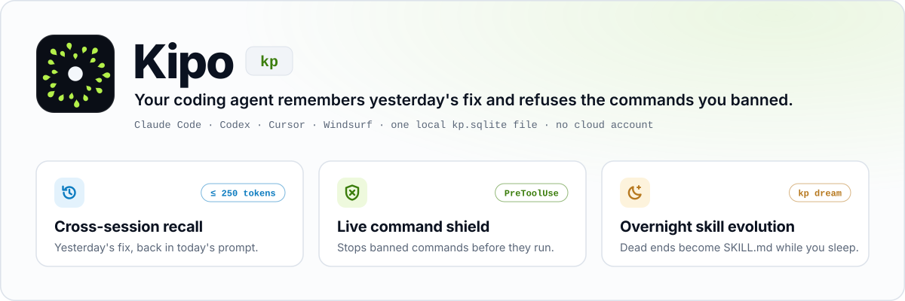

<p align="center">
  <picture>
    <source media="(prefers-color-scheme: dark)" srcset="docs/assets/kipo-hero-dark.svg">
    
  </picture>
</p>

<p align="center">
  <a href="https://github.com/junjamrk/kipo/actions/workflows/ci.yml"></a>
  <a href="https://github.com/junjamrk/kipo/releases"></a>
  <a href="LICENSE"></a>
  <a href="rust-toolchain.toml"></a>
</p>

<p align="center">
  <strong>English</strong> ·
  <a href="README.zh-CN.md">简体中文</a> ·
  <a href="#quick-start">Quick start</a> ·
  <a href="#why-kipo">Why Kipo</a> ·
  <a href="#how-it-works">How it works</a> ·
  <a href="#core-workflows">Core workflows</a> ·
  <a href="#cli-reference">CLI reference</a> ·
  <a href="TUTORIAL.md">Tutorial</a> ·
  <a href="examples/showcase/README.md">Benchmarks &amp; replay</a> ·
  <a href="docs/ARCHITECTURE.md">Architecture</a> ·
  <a href="CONTRIBUTING.md">Contributing</a>
</p>

# Kipo (`kp`)

**Kipo (`kp`)** is a local-first memory database for AI coding agents and engineering teams. It stores redacted verbatim sources, bitemporal claims, read-time provenance proofs, and distilled skills inside a single WAL SQLite file (`kp.sqlite`) with zero cloud lock-in.

<p align="center">
  
</p>

<!--
Video walkthrough embed: after pushing to GitHub, drag the 4.8 MB 720p narrated explainer MP4 into the GitHub web editor and paste the generated standalone https://github.com/user-attachments/assets/<uuid> line right below to render GitHub's native HTML5 video player.
-->

<p align="center">
  <a href="TUTORIAL.md">
    
  </a>
</p>

---

## Quick start

### 1. Install `kp`

**Homebrew (macOS and Linux)**

```sh
brew install junjamrk/tap/kipo
```

**Standalone binary installer (verifies `SHA256SUMS` before staging)**

```sh
# macOS and Linux (x86_64 and aarch64, glibc >= 2.28)
curl -fsSL https://raw.githubusercontent.com/junjamrk/kipo/main/scripts/install.sh | sh

# Windows PowerShell (x86_64 and arm64)
irm https://raw.githubusercontent.com/junjamrk/kipo/main/scripts/install.ps1 | iex
```

> [!TIP]
> Every official GitHub Release archive carries a cryptographic Sigstore build provenance attestation. Verify any downloaded archive locally with `gh attestation verify kipo-<target>.tar.gz --repo junjamrk/kipo`.

**Build from source with Cargo**

```sh
# Core CLI + local ONNX embeddings (`kp` binary)
cargo install --git https://github.com/junjamrk/kipo kipo

# Include decoupled external connectors (`kp connector` subcommand + `kp-connector` binary)
cargo install --git https://github.com/junjamrk/kipo kipo --features connectors
cargo install --git https://github.com/junjamrk/kipo kp-connect
```

### 2. Run the 5-minute offline interactive tour

No API keys, cloud accounts, or network access are required. One command exercises Claude Code and Codex hook wiring, Public Ingest JSONL records, `StalePremise` truth maintenance, `<kp-context>` recall, dual-client `PreToolUse` guards, lossless Markdown `export` and `apply`, and `carol` zero-leakage isolation:

```sh
kp demo
# Keep the generated demo library on disk to inspect afterward:
kp demo --dir ./kipo-demo
kp inspect --path ./kipo-demo/demo-lib --as alice
```

### 3. Connect your coding agent in three commands

```sh
kp init --path ~/.kp/personal --owner alice --name "Alice Personal"
kp connect claude-code --project . --path ~/.kp/personal --as alice
kp connect codex --project . --path ~/.kp/personal --as alice
```

Cursor and Windsurf MCP configurations are also supported out of the box:

```sh
kp connect cursor --project . --path ~/.kp/personal --as alice
kp connect windsurf --global --path ~/.kp/personal --as alice
```

---

## Why Kipo

Most agent memory tools either paste static Markdown files into every prompt or upload raw transcripts to a shared cloud vector store where permissions, retractions, and expired constraints bleed across teammates.

| Dimension | Static rules (`CLAUDE.md`) | Shared cloud vector RAG | Kipo (`kp`) |
| --- | --- | --- | --- |
| **Storage footprint** | Unindexed flat files | External vector + graph servers | Single local `kp.sqlite` WAL file |
| **Derived summary ACLs** | None (repo-wide) | Copied at write time; stale on roster change | Evaluated at read time via provenance semiring |
| **Retraction (`forget` / `purge`)** | Manual file grep across repos | Stale summary vectors linger until re-index | `0 ms` cascade invalidation + HMAC tombstone |
| **Prompt context cost** | Grows linearly with file size | Often injects thousands of tokens | Hard cap of `<= 250 tokens` and `<= 3 items` |
| **Dangerous command guard** | Passive prompt text only | None | Active `PreToolUse` check (`ask` / `deny` + `kp allow`) |
| **Offline & `RawOnly` mode** | Yes | Cloud-dependent | 100% offline capable; `0` outbound calls under `RawOnly` |

<p align="center">
  
</p>

Three architectural choices separate Kipo from conventional memory layers:

1. **Isomorphic single-file SQLite engine.** Personal libraries and shared team libraries run the exact same Rust engine and `kp.sqlite` schema: redacted content-addressed `raw_blobs`, `jieba-rs` CJK and English FTS5 (`contentless_delete=1`), normalized vector embeddings, bitemporal `facts`, and JTMS `justifications`. A Personal Library is simply a 1-member Community Library.
2. **Read-time provenance semiring with non-interference.** Audience sets (`aud`) and validity windows (`[valid_from, valid_until)`) are never copied onto derived conclusions. Collision warnings, syntheses, concept alignments, and distilled skills evaluate `(viewer, time)` across the justification DAG at read time. When a member leaves a container, a window expires, or a premise is withdrawn (`kp forget` or `kp purge`), dependent conclusions disappear immediately and unauthorized viewers receive byte-identical responses.
3. **Platform-agnostic core and closed JSONL contract.** Core crates contain zero chat-vendor or issue-tracker schemas. Claude Code hooks, Codex hooks, decoupled connectors (`kp-connect`), MCP `kp_note`, and custom shell scripts all write through the same Draft 2020-12 JSON Schema documented in [docs/INGEST-SCHEMA.md](docs/INGEST-SCHEMA.md).

---

## How it works

<p align="center">
  
</p>

The Cargo workspace compiles into a single primary binary (`kp`) plus an optional standalone connector binary (`kp-connector`) across 8 acyclic crates (`unsafe_code = "forbid"`, `unwrap_used = "deny"`, `expect_used = "deny"`):

```text
kipo/
├── Cargo.toml                  # Workspace manifest (Apache-2.0, MSRV 1.89, zero unsafe)
├── scripts/
│   ├── install.sh              # POSIX installer with SHA-256 and binary self-check
│   ├── install.ps1             # Windows PowerShell installer with SHA-256 verification
│   └── verify-oss-readiness.py # Link, anchor, SVG, workflow, and privacy gate verifier
├── docs/
│   ├── ARCHITECTURE.md         # SQLite schema, semiring math, and security invariants
│   └── INGEST-SCHEMA.md        # Normative Draft 2020-12 JSONL wire specification
└── crates/
    ├── kp-model/               # Domain types, Provenance Semiring, PublicIngestLine, SecretRedactor
    ├── kp-store/               # Single-file WAL SQLite, CJK FTS5, ONNX + HTTP embedders, Export/Apply
    ├── kp-derive/              # Batched LLM/CLI extraction, Datalog rules, JTMS cascade, why() proofs
    ├── kp-retrieve/            # Scoped hybrid search (BM25 + Vec + RRF + DPP), PreToolUse guards, Judges
    ├── kp-ingest/              # Agent hooks, tree-sitter symbol anchors, PDF/Office/Web router, kp dream
    ├── kp-net/                 # Private 0700 UDS daemon, 127.0.0.1 Web Inspector, Community Axum server
    ├── kp-connect/             # Decoupled connectors (kp-connector: GitHub, Feishu, Sessions -> JSONL)
    └── kp-cli/                 # Package kipo -> binary kp (CLI, demo, daemon, inspector, MCP, serve)
```

---

## Core workflows

### 1. Non-intrusive hooks, bounded recall, and `PreToolUse` guards

* **Zero-blocking capture.** The first hook invocation auto-spawns `kp daemon` over a private `0700` Unix Domain Socket without blocking the agent turn. Transcripts pass through `SecretRedactor` before SQLite persistence and drain asynchronously in leased batches.
* **Bounded prompt injection.** `UserPromptSubmit` injects at most `250 tokens` and `3 items`, each anchored with verbatim speaker quotes (`↳`). Irrelevant prompts return `{}`.
* **Typed `PreToolUse` command guards.** Write-time `CommandGuardSpec` extraction and explicit `[forbid: <cmd>]`, `[allow: <cmd>]`, or `[require_flag: <cmd> <flag>]` tags guard mutating shell calls:
  * **Claude Code:** returns `permissionDecision = "ask"` with the verbatim citation chain.
  * **Codex:** returns `permissionDecision = "deny"` and prints a single-use 10-minute `kp allow <kp-ref>` override command for the library owner.
* **Low-noise governance.** Ambiguous scopes start narrow (`SelfOnly`) and enter `kp review` only when cross-member impact exists. Running `kp reject <fact_id> --reason "..."` withdraws a claim and writes a sticky dual-key rejection record so re-mining the same transcript never resurrects it.

### 2. Document, code symbol, and web ingestion (`kp add` and `kp verify`)

Import Markdown, source code (`rs`, `py`, `ts`, `tsx`, `js`, `jsx`, `go`), DOCX, PPTX, XLSX, PDF, HTML, and SSRF-guarded `http://` or `https://` pages with pre-persistence secret redaction and fine-grained anchors:

```sh
kp add ./docs ./notes/runbook.docx --path ~/.kp/personal --as alice
kp add https://example.com/runbook.html --path ~/.kp/personal --as alice

# Anchor an API contract to a Rust symbol and detect signature drift later:
kp remember --subject settle_invoice --predicate kp.code.api_contract \
  --value "Validate request schema version before settlement" \
  --repo . --file src/billing.rs --symbol settle_invoice --path ~/.kp/personal
kp verify --repo . --path ~/.kp/personal --json
```

Scanned or garbled PDF pages return `needs_ocr: true` and are quarantined rather than polluting the lexical or vector index.

### 3. Public JSONL ingest and decoupled connectors (`kp ingest` and `kp-connector`)

Stream container rosters and `upsert`, `supersede`, or `withdraw` records from files, `stdin`, stdio MCP (`kp mcp`), or `kp-connector` (zero dependency on `kp-store`):

```sh
cat <<'JSONL' | kp ingest - --path ~/.kp/personal --as alice --json
{"container_id":"scope.release","label":"Release Oncall","members":["alice","bob"],"all_library_members":false,"synced_at":1795089600000}
{"source":{"kind":"chat","uri":"chat://release/msg-101","external_id":"msg-101","container_id":"scope.release"},"speaker":"bob","audience":"container_members","occurred_at":"2026-11-22T10:00:00Z","content":"Database freeze starts Friday 18:00 UTC; pause schema migrations until Monday.","op":"upsert"}
JSONL

# Sync GitHub collaborators, issues, and pull requests incrementally via ETag + since windows:
kp-connector --state ~/.kp/connectors/state.json scope add \
  --kind github --scope-id repo.kipo --upstream junjamrk/kipo --label "Kipo Repo"
kp-connector --state ~/.kp/connectors/state.json sync --kind github --ingested-by alice \
  | kp ingest - --path ~/.kp/personal --as alice --json
```

Built-in connectors cover **GitHub REST API**, **Feishu / Lark (`lark-cli`)** (messages, recalls, edits, member roster contraction, wiki and drive docs), and **Claude Code / Codex session backfills**.

### 4. Local ONNX embeddings and multi-provider recipes

`kp init` defaults to local ONNX embeddings (`local:bge-small-zh-v1.5`, SHA-256 verified under `~/.kp/models/`, falling back to `jieba-rs` BM25 FTS5 when offline) and includes built-in recipes for `openai`, `voyage`, `google`, `openrouter`, `dashscope`, `volcengine`, `zhipu`, and `ollama` with library-level dimension locking:

```sh
kp providers list
kp providers env openai
kp providers test --path ~/.kp/personal --json
kp embed --stale --to local:bge-small-zh-v1.5 --path ~/.kp/personal --json
```

### 5. Read-only `127.0.0.1` Web Inspector and lossless Markdown write-back

Inspect what Kipo remembers through a loopback-only, CSP-hardened four-column browser UI (`What Kipo Remembers`, `Why It Remembers`, `What Changed`, and `Pending Reviews`), or roundtrip memories through plain Markdown files protected by `base_seq` optimistic concurrency:

```sh
kp inspect --path ~/.kp/personal --as alice

kp export ./memory-md --path ~/.kp/personal --as alice --json
# Edit or delete entries in ./memory-md/, then write changes back:
kp apply ./memory-md --path ~/.kp/personal --as alice --json
kp log --limit 20 --path ~/.kp/personal --json
```

### 6. Sleep-time consolidation and governed skill evolution (`kp dream`)

`kp dream` mines coding sessions, ratified multi-turn chat threads, and imported documents into governed facts, typed `CommandGuardSpec` rules, and `<library>/skills/<slug>/SKILL.md` packages:

```sh
kp dream --sessions ~/.codex/sessions ~/.claude/projects --path ~/.kp/personal --json
kp skill list --path ~/.kp/personal --json
kp feedback check-api-contract --outcome helped --task pr-142 --path ~/.kp/personal --json
```

* **Zero-config model routing.** Uses logged-in host CLIs (`claude` or `codex`) or configured HTTP LLM endpoints. Under `KP_MODEL_POLICY=raw_only`, Kipo indexes L0 chunks with zero network egress and zero heuristic fact fabrication.
* **Evidence-gated promotion and retirement.** Promotion to `SKILL.md` requires `helped >= 2` across distinct tasks and `hurt == 0`. Skills retire automatically when `hurt >= 2`, when `hurt >= 1 && hurt >= helped`, or when supporting premises drop below quorum after `kp forget` or `kp purge`. Imported community skills stay quarantined (`exec_approved: false`) until the local owner runs `kp skill approve <slug>`.

### 7. Isomorphic team collaboration (`kp serve --community` and `kp sync`)

Host a shared Community Library with the same `kp` binary over HTTP REST, Streamable HTTP MCP (`/mcp`), and A2A (`/.well-known/agent.json`, `/a2a`):

```sh
kp init --community --owner admin --name "Eng Team" --path ./team-lib
kp member add alice --path ./team-lib --json
kp member add bob --path ./team-lib --json
kp serve --community --listen 127.0.0.1:8080 --path ./team-lib

# On Alice's machine: join once, then background daemon syncs shared claims via durable outbox
kp community join http://127.0.0.1:8080 --token "$ALICE_TOKEN" --path ~/.kp/personal --json
```

Walk through the complete multi-member scenario step by step in [TUTORIAL.md](TUTORIAL.md).

---

## CLI reference

Global flags apply to every subcommand: `--path <DIR>` (library path, defaults to `.`), `--as <ACTOR>` (defaults to library owner), and `--json` (structured JSON on stdout, JSON errors on stderr).

| Group | Subcommands | Purpose |
| --- | --- | --- |
| **Bootstrap & tour** | `init`, `status`, `demo`, `member add` | Create personal or community libraries, check health, run the 5-minute offline tour, issue member tokens |
| **Agent integrations** | `connect`, `hook`, `daemon`, `inspect`, `mcp` | Wire Claude Code / Codex / Cursor / Windsurf, manage the `0700` UDS daemon, open the `127.0.0.1` Web Inspector, serve stdio MCP |
| **Ingest & memory** | `add`, `ingest`, `remember`, `dead-end`, `verify` | Import files/URLs, stream Public Ingest JSONL, record structured claims or failed hypotheses, verify `tree-sitter` anchors |
| **Search & proofs** | `search`, `why`, `derive`, `synthesize` | Run viewer-isolated hybrid search (`--deep`, `--at`, `--also-library`), inspect semiring proof trees, generate scoped syntheses |
| **Governance & lifecycle** | `review`, `allow`, `reject`, `forget`, `purge`, `identity bind` | Resolve ambiguous scopes, grant single-shot guard overrides, reject bad extractions, withdraw claims, or erase blobs with HMAC tombstones |
| **Projection & vectors** | `export`, `apply`, `log`, `providers`, `embed` | Roundtrip Markdown projections, inspect viewer-scoped audit history, test or migrate local ONNX and cloud embeddings |
| **Sleep-time RSI** | `dream`, `episode record`, `skill`, `feedback` | Consolidate sessions into skills, approve imported community skills, record task-deduplicated `helped` or `hurt` outcomes |
| **Community & connectors** | `community`, `serve`, `publish`, `sync`, `connector` | Join remote communities, run the HTTP/MCP/A2A community server, sync outboxes, run decoupled GitHub/Feishu/session connectors |

---

## Development and verification

Every unit, integration, hook, daemon, Web Inspector, connector, and end-to-end test runs 100% offline without external API keys:

```sh
sh -n scripts/install.sh
python3 scripts/verify-oss-readiness.py
cargo fmt --all -- --check
cargo clippy -p kipo --all-targets --no-default-features --locked -- -D warnings
cargo clippy --workspace --all-targets --all-features --locked -- -D warnings
KP_OFFLINE=1 KP_DISABLE_MODEL_DOWNLOAD=1 cargo test --workspace --all-features --locked
```

See [CONTRIBUTING.md](CONTRIBUTING.md) for crate boundary rules, coding standards, and instructions for adding embedding recipes or external connectors.

---

## Security, governance, and license

* **Security policy & vulnerability reporting:** [SECURITY.md](SECURITY.md)
* **Support & diagnostics:** [SUPPORT.md](SUPPORT.md)
* **Contributing guide:** [CONTRIBUTING.md](CONTRIBUTING.md)
* **Code of conduct:** [CODE_OF_CONDUCT.md](CODE_OF_CONDUCT.md)
* **Release history:** [CHANGELOG.md](CHANGELOG.md)
* **License:** Licensed under the [Apache License, Version 2.0](LICENSE). Attributions for permissively adapted open-source algorithms, prompt structures, and dependencies are documented in [THIRD_PARTY_NOTICES.md](THIRD_PARTY_NOTICES.md).
