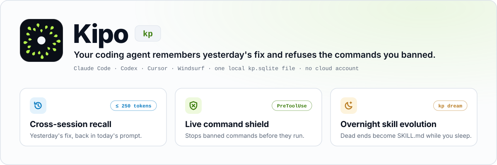
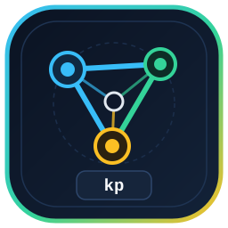

<p align="center">
  <picture>
    <source media="(prefers-color-scheme: dark)" srcset="docs/assets/kipo-hero-dark.svg">
    
  </picture>
</p>

<p align="center">
  <a href="https://github.com/junjamrk/kipo/actions/workflows/ci.yml"></a>
  <a href="https://github.com/junjamrk/kipo/releases"></a>
  <a href="LICENSE"></a>
  <a href="rust-toolchain.toml"></a>
</p>

<p align="center">
  <a href="README.md">English</a> ·
  <strong>简体中文</strong> ·
  <a href="#快速开始">快速开始</a> ·
  <a href="#kipo-能帮你做什么">能做什么</a> ·
  <a href="#kipo-怎么融入你的日常">工作流</a> ·
  <a href="#命令速览">命令速览</a> ·
  <a href="TUTORIAL.md">实战教程</a> ·
  <a href="examples/showcase/README.md">基准与回放</a> ·
  <a href="docs/ARCHITECTURE.md">架构</a>
</p>

# Kipo (`kp`)



昨天好不容易调通的 bug，今天的智能体全忘了；团队刚宣布封版，它转头就去跑数据库迁移。**Kipo 给 Claude Code、Codex、Cursor 和 Windsurf 装上记忆和命令护栏，所有数据都在本地一个文件 `kp.sqlite` 里，不用注册任何云服务。**

<br clear="right">

<p align="center">
  
</p>

## 看一分钟预告片

<p align="center">
  <a href="https://github.com/junjamrk/kipo/raw/main/docs/assets/kipo-explainer.mp4">
    
  </a>
</p>

<p align="center">
  <a href="https://github.com/junjamrk/kipo/raw/main/docs/assets/kipo-explainer.mp4">
    
  </a>
</p>

<p align="center">
  <a href="https://github.com/junjamrk/kipo/raw/main/docs/assets/kipo-explainer.mp4"><strong>播放预告片（带音频 MP4）</strong></a> ·
  <a href="docs/assets/kipo-explainer.mp4">查看视频文件</a> ·
  <a href="TUTORIAL.md">跑一遍 5 分钟离线体验</a>
</p>

## 这些坑，你肯定踩过

| 你每周都在… | Kipo 帮你… |
| --- | --- |
| 把昨天的解决方案再给智能体讲一遍 | 下一次提问时自动带上，不超过 250 个 token |
| 眼看着它执行团队明令禁止的命令 | 在 `PreToolUse` 阶段直接拦下，命令根本跑不起来 |
| 每次会话都塞一个巨长的 `CLAUDE.md` | 只发送和当前问题相关的 3 条记忆 |
| 不敢用共享 RAG，怕私人笔记泄露 | 每个队友只能看到自己有权看的内容 |

所有数据都在你硬盘上的一个 SQLite 文件里。断网照常工作，随时可以打开、检查或者直接删掉。

## 快速开始

### 安装

```sh
# Homebrew（macOS 和 Linux）
brew install junjamrk/tap/kipo

# macOS 和 Linux 安装脚本（安装前校验 SHA256SUMS）
curl -fsSL https://raw.githubusercontent.com/junjamrk/kipo/main/scripts/install.sh | sh

# Windows PowerShell
irm https://raw.githubusercontent.com/junjamrk/kipo/main/scripts/install.ps1 | iex

# 从源码安装
cargo install --git https://github.com/junjamrk/kipo kipo
```

> [!TIP]
> 每个 Release 压缩包都带 Sigstore 构建证明。下载后可以用 `gh attestation verify kipo-<target>.tar.gz --repo junjamrk/kipo` 校验。

### 一条命令离线体验

```sh
kp demo
```

不需要 API key，也不需要联网。它会在一个临时库里接好 Claude Code 和 Codex 的 hook，演示上下文召回、危险命令拦截，并证明不在可见范围内的队友什么也看不到。加上 `--dir ./kipo-demo` 可以保留这个库，再用 `kp inspect --path ./kipo-demo/demo-lib --as alice` 打开看看。

### 接入你的智能体

```sh
kp init --path ~/.kp/personal --owner alice --name "Alice Personal"
kp connect claude-code --project . --path ~/.kp/personal --as alice
kp connect codex --project . --path ~/.kp/personal --as alice
```

Cursor 和 Windsurf 通过 MCP 接入：

```sh
kp connect cursor --project . --path ~/.kp/personal --as alice
kp connect windsurf --global --path ~/.kp/personal --as alice
```

配置到此结束。之后 Kipo 会在后台记录每次会话，绝不卡住智能体的回合。

## Kipo 能帮你做什么

### 1. 跨会话记忆，每次不超过 250 个 token

每次你提问时，`UserPromptSubmit` hook 最多补充 3 条相关记忆，总量不超过 250 个 token，每条都附上原话出处。问题和记忆无关时，什么都不加。

Kipo 会自己从会话里学习。想手动记一笔，用 `kp remember` 记事实，用 `kp dead-end` 记下走不通的路：

```sh
kp remember --subject settle_invoice --predicate kp.core.note \
  --value "账单测试不稳定的根因是 settle_invoice 里的加锁顺序" \
  --path ~/.kp/personal --as alice

kp dead-end --subject settle_invoice \
  --hypothesis "重试 HTTP mock" --reason "竞态出在加锁顺序，跟网络无关" \
  --path ~/.kp/personal --as alice
```

明天的新会话一开始就知道这两件事，不会再绕一遍弯路。

### 2. 危险命令，执行前就拦下

写一条带 `[forbid: ...]` 标签的规则，智能体每次要跑 shell 命令，Kipo 都会先对照检查：

```sh
cat > release-rules.md <<'EOF'
# 发布规则
- constraint: 周一 09:00 UTC 之前数据库封版 [forbid: `sqlx migrate`]
- constraint: 用 pnpm，不要用 npm [forbid: `npm install`] [allow: `pnpm install`]
EOF
kp add release-rules.md --extract --path ~/.kp/personal --as alice
```

智能体一跑 `sqlx migrate run`，`PreToolUse` hook 就会拦下它，并引用对应的规则：

* **Claude Code** 会弹出确认，等你批准。
* **Codex** 会直接拒绝，并给出一条一次性放行命令 `kp allow kp-ref:<id>`，10 分钟后失效。

`[require_flag: <cmd> <flag>]` 可以强制命令必须带某个参数，比如每次迁移都要带 `--schema`。

### 3. 读懂你的代码、文档和网页

```sh
kp add ./docs --path ~/.kp/personal --as alice
kp add ./notes/runbook.docx --path ~/.kp/personal --as alice
kp add https://example.com/runbook.html --path ~/.kp/personal --as alice
```

`kp add` 支持 Markdown、源码（Rust、Python、TypeScript、JavaScript、Go）、PDF、DOCX、PPTX、XLSX、HTML 和网页。写入数据库之前，Kipo 会先抹掉其中的 API key、token 和密码。

把一条笔记钉在某个函数上，代码一变，`kp verify` 就会提醒你：

```sh
kp remember --subject settle_invoice --predicate kp.code.api_contract \
  --value "结算前先校验请求的 schema 版本" \
  --repo . --file src/billing.rs --symbol settle_invoice --path ~/.kp/personal
kp verify --repo . --path ~/.kp/personal --json
```

### 4. 睡一觉，踩过的坑变成 `SKILL.md`

`kp dream` 会翻阅你过去的 Claude Code 和 Codex 会话，把真正管用的做法整理成智能体可以直接加载的 `SKILL.md`：

```sh
kp dream --sessions ~/.claude/projects --sessions ~/.codex/sessions --path ~/.kp/personal
kp skill list --path ~/.kp/personal
kp feedback check-api-contract --outcome helped --task pr-142 --path ~/.kp/personal
```

一个技能要在 2 个不同任务上帮过忙、且从没帮倒忙，才会启用；一旦开始帮倒忙，就自动下线。队友分享来的技能默认不生效，你执行 `kp skill approve <slug>` 之后才会启用。

`kp dream` 直接用你已经登录的 `claude` 或 `codex` CLI。设置 `KP_MODEL_POLICY=raw_only` 后，所有处理都留在本机，零网络请求。

### 5. 说忘就忘，团队共享不泄密

<p align="center">
  
</p>

```sh
kp forget release-freeze --path ~/.kp/personal   # 0 毫秒内从所有提示和摘要中消失
kp purge release-freeze --path ~/.kp/personal    # 连原文一起彻底删除
kp inspect --path ~/.kp/personal --as alice      # 本地网页：Kipo 记住了什么、为什么记住
```

需要团队库时，用同一个 `kp` 就能跑起来：

```sh
kp init --community --owner admin --name "Eng Team" --path ./team-lib
kp member add alice --path ./team-lib --json
kp serve --community --listen 127.0.0.1:8080 --path ./team-lib

kp publish release-freeze --to http://127.0.0.1:8080 --token "$ALICE_TOKEN" \
  --audience alice,bob --path ~/.kp/personal
kp sync --from http://127.0.0.1:8080 --token "$BOB_TOKEN" --path ~/.kp/bob
```

bob 能看到封版通知。carol 不在可见范围内，她搜出来的结果是空的，和这条笔记从没存在过一模一样。完整的团队协作流程见 [TUTORIAL.md](TUTORIAL.md)。

## Kipo 怎么融入你的日常

<p align="center">
  
</p>

Kipo 默认在本机用本地模型生成向量。想换成云端向量模型，运行 `kp providers list` 查看内置方案，包括 `openai`、`voyage`、`google`、`openrouter`、`dashscope`、`volcengine`、`zhipu` 和 `ollama`。

## 命令速览

所有命令都支持 `--path <DIR>`（库所在目录）、`--as <ACTOR>`（以谁的身份）和 `--json`（机器可读输出）。

| 你想… | 命令 |
| --- | --- |
| 安装体验 | `init`、`demo`、`status`、`connect` |
| 教它新东西 | `remember`、`dead-end`、`add`、`ingest` |
| 查找和追溯 | `search`、`why`、`inspect`、`log` |
| 管住命令 | `allow`、`review`、`reject` |
| 删除记忆 | `forget`、`purge` |
| 积累技能 | `dream`、`skill list`、`skill approve`、`feedback` |
| 用 Markdown 编辑记忆 | `export`、`apply` |
| 和团队共享 | `serve`、`member add`、`community join`、`publish`、`sync` |

运行 `kp <command> --help` 查看全部参数。

## 背后的原理

好奇 0 毫秒撤回和不泄密的权限是怎么做到的？Kipo 从不把权限复制到它生成的摘要和警告上，而是在每次读取时，根据这些内容的来源笔记现算谁能看。撤回一条笔记、移除一位队友、或者到了过期时间，下一次读取时所有人看到的结果就随之改变。想深入了解：存储设计和安全规则见[架构文档](docs/ARCHITECTURE.md)，用自己的脚本向 Kipo 写数据见[写入协议](docs/INGEST-SCHEMA.md)，基准测试和真实回放见[基准与回放](examples/showcase/README.md)，完整上手流程见 [TUTORIAL.md](TUTORIAL.md)，提交代码见 [CONTRIBUTING.md](CONTRIBUTING.md)，报告漏洞见 [SECURITY.md](SECURITY.md)。

## 本地开发

所有测试都能离线运行，不需要 API key：

```sh
python3 scripts/verify-oss-readiness.py
cargo fmt --all -- --check
cargo clippy --workspace --all-targets --all-features --locked -- -D warnings
KP_OFFLINE=1 KP_DISABLE_MODEL_DOWNLOAD=1 cargo test --workspace --all-features --locked
```

## 安全、支持与许可证

* 报告漏洞：[SECURITY.md](SECURITY.md)
* 获取帮助：[SUPPORT.md](SUPPORT.md)
* 参与贡献：[CONTRIBUTING.md](CONTRIBUTING.md) 和 [CODE_OF_CONDUCT.md](CODE_OF_CONDUCT.md)
* 版本历史：[CHANGELOG.md](CHANGELOG.md)
* 许可证：[Apache License 2.0](LICENSE)。第三方署名见 [THIRD_PARTY_NOTICES.md](THIRD_PARTY_NOTICES.md)。
